# stream-bot

[](https://github.com/vonavikon/stream-bot)
[](https://www.virustotal.com/gui/file/c47eec3346a3872030fa044f3bdbe7402ffc21ca7079e865a8332d260341db5a)

[RU](README.md) · **EN** · [中文](README.zh.md) · [Español](README.es.md) · [Français](README.fr.md)

A Telegram bot for capturing thoughts, links, and questions on the go. Each entry lands as a checkbox in a capture buffer (`wiki/stream.md`) and gets its domain assigned automatically by a language model. A replacement for "forward it to Saved Messages", but with a manual review afterwards.

## What it does

You send the bot anything: text, a link, a forward. No commands, no formatting. The bot saves the entry as a checkbox `- [ ] YYYY-MM-DD HH:MM — text` (timestamp in Moscow time) under the `## Входящее` section of `wiki/stream.md` and tags the domain in the background (`ai` / `career` / `dev` / `infra` / `product` / `pm` / `personal` / `naumen` / `learning`); for tasks it rewrites the raw text into a clean wording and strikes through junk. The file is committed and pushed to git.

```
Telegram → appendEntry → wiki/stream.md (## Входящее, чекбоксом)
                        ↓
            classify (claude-haiku-4.5): type + domain
                        ↓
            refineEntry (домен + чистая формулировка) / strikeTrash → git push
```



The point is to separate capture from processing. On the go you dump everything into one place without thinking about format; at the computer you go through the entries by hand and decide on each one: do it, turn it into a note, defer it, or delete it.

## Commands

| Command | Action |
|---------|--------|
| `/start` | greeting |
| `/stream` | `Входящее`: total count and how many untagged |
| `/triage` | batch-tagging of all untagged entries |
| (any text) | save the entry, 👌 reaction, background triage, reply with the detected type |

The bot responds only to `TELEGRAM_CHAT_ID` — this is a personal tool, not a public one.

## Stack

| Component | Technology | Why |
|-----------|------------|-----|
| Bot | TypeScript + [grammY](https://grammy.dev/) | receiving messages from Telegram |
| Classification | OpenAI-compatible call, `claude-haiku-4.5` (bothub) | entry type and domain |
| Storage | markdown file | readable format, no vendor lock-in |
| Sync | git | versioning and synchronization across devices |
| Deploy | Docker | runs 24/7 on a VPS |

## Setup

You need a Telegram bot (token from [@BotFather](https://t.me/BotFather)), a bothub API key, and a git repo of notes.

```bash
git clone https://github.com/vonavikon/stream-bot.git
cd stream-bot
cp .env.example .env
# заполнить .env
docker compose up -d --build
docker compose logs -f
```

### Where it writes

The bot is the only writer to `<WIKI_PATH>/wiki/stream.md`, the capture buffer. `WIKI_PATH` is the root of the git repo (where `.git` lives); in `docker-compose.yml` it is mounted at `/app/wiki`. New entries land as checkboxes under the `## Входящее` section (if it is missing, the bot creates it):

```markdown
## Входящее

- [ ] 2026-07-29 14:20 — изучить статью про RAG `#ai`
- [ ] 2026-07-29 09:05 — купить кофе `#personal`
```

You then move entries from `stream.md` into your task file (`wiki/tasks.md`) or wherever they belong — the bot never writes there. The separation gives each file a single writer: otherwise parallel edits by the bot and an Obsidian plugin sync produce conflicting copies.

## Config (.env)

| Variable | Purpose |
|----------|---------|
| `TELEGRAM_BOT_TOKEN` | bot token from BotFather |
| `TELEGRAM_CHAT_ID` | chat id — the bot responds only to this chat |
| `BOTHUB_API_KEY` | bothub key (JWT from the personal dashboard) |
| `BOTHUB_BASE_URL` | OpenAI-compatible endpoint (default `https://openai.bothub.chat/v1`; any gateway can be plugged in) |
| `MODEL` | classifier model (default `claude-haiku-4.5`) |
| `WIKI_PATH` | path to the notes repo inside the container (`/app/wiki`) |

## Git sync

The container acts as the single writer to the notes repo. Before every entry: `git fetch` + `reset --hard origin/main` (discards local divergence), then `add -A` + `commit` + `push`. Harsh, but deterministic: the bot always overwrites the ref and pushes its own state. On other devices changes arrive through a regular `git pull`. The branch is `main`.

## Roadmap

Right now the bot accepts only text. The growth directions run through a multimodal LLM gateway (STT, vision, embeddings under one key), in order of decreasing payoff:

1. **Voice input (STT).** `voice` → transcription → the usual classification path. Half of the production entries are short on-the-go sketches; voice fits the "hands busy" scenario better.
2. **Photos and screenshots (vision).** `photo` → OCR + description → entry. Photos are silently skipped today.
3. **Link enrichment.** URL in an entry → fetch the page → a short summary → entry with context. Fixes the "later I can't remember why I saved this" problem.
4. **Deduplication (embeddings).** On a new entry — embedding, search for similar ones in `stream.md` and the archive. A near-duplicate gets a `trash` tag or a link.

## License

MIT — see [LICENSE](LICENSE).
