# stream-bot

[](https://github.com/vonavikon/stream-bot)

[RU](README.md) · [EN](README.en.md) · [中文](README.zh.md) · **Español** · [Français](README.fr.md)

Un bot de Telegram para capturar ideas, enlaces y preguntas sobre la marcha. Cada entrada queda como checkbox en un búfer de captura (`wiki/stream.md`) y un modelo de lenguaje le asigna el dominio automáticamente. Un reemplazo de "reenviármelo a Guardados", pero con revisión manual después.

## Qué hace

Le envías al bot lo que sea: texto, un enlace, un reenvío. Sin comandos ni formato. El bot guarda la entrada como checkbox `- [ ] YYYY-MM-DD HH:MM — texto` (hora de Moscú) en la sección `## Входящее` de `wiki/stream.md` y en segundo plano le asigna el dominio (`ai` / `career` / `dev` / `infra` / `product` / `pm` / `personal` / `naumen` / `learning`); a las tareas les reescribe el texto bruto en una formulación limpia y tacha la basura. El archivo pasa por commit y push a git.

```
Telegram → appendEntry → wiki/stream.md (## Входящее, чекбоксом)
                        ↓
            classify (claude-haiku-4.5): type + domain
                        ↓
            refineEntry (домен + чистая формулировка) / strikeTrash → git push
```



La idea es separar la captura del procesamiento. Sobre la marcha vuelcas todo en un solo punto, sin pensar en el formato; en la computadora recorres las entradas a mano y decides con cada una: hacerla, convertirla en nota, dejarla para luego o borrarla.

## Comandos

| Comando | Acción |
|---------|--------|
| `/start` | saludo |
| `/stream` | `Входящее`: total y cuántas sin etiqueta |
| `/triage` | etiquetado por lotes de todas las entradas sin etiqueta |
| (cualquier texto) | guardar la entrada, reacción 👌, triaje en segundo plano, respuesta con el tipo detectado |

El bot responde solo a `TELEGRAM_CHAT_ID`: es una herramienta personal, no pública.

## Stack

| Componente | Tecnología | Para qué |
|-----------|------------|----------|
| Bot | TypeScript + [grammY](https://grammy.dev/) | recibir mensajes de Telegram |
| Clasificación | llamada compatible con OpenAI, `claude-haiku-4.5` (bothub) | tipo y dominio de la entrada |
| Almacenamiento | archivo markdown | formato legible, sin vendor lock-in |
| Sincronización | git | versionado y sincronización entre dispositivos |
| Despliegue | Docker | corre 24/7 en un VPS |

## Instalación

Necesitas un bot de Telegram (token de [@BotFather](https://t.me/BotFather)), una clave de API de bothub y un repo git de notas.

```bash
git clone https://github.com/vonavikon/stream-bot.git
cd stream-bot
cp .env.example .env
# заполнить .env
docker compose up -d --build
docker compose logs -f
```

### Dónde escribe

El bot es el único escritor de `<WIKI_PATH>/wiki/stream.md`, el búfer de captura. `WIKI_PATH` es la raíz del repo git (donde está `.git`); en `docker-compose.yml` se monta en `/app/wiki`. Las entradas nuevas caen como checkboxes en la sección `## Входящее` (si no existe, el bot la crea):

```markdown
## Входящее

- [ ] 2026-07-29 14:20 — изучить статью про RAG `#ai`
- [ ] 2026-07-29 09:05 — купить кофе `#personal`
```

Luego las entradas de `stream.md` las pasas a tu archivo de tareas (`wiki/tasks.md`) o a donde haga falta: el bot no escribe ahí. La separación existe para que cada archivo tenga un solo escritor; si no, las ediciones paralelas del bot y la sincronización de un plugin de Obsidian generan copias en conflicto.

## Configuración (.env)

| Variable | Función |
|----------|---------|
| `TELEGRAM_BOT_TOKEN` | token del bot de BotFather |
| `TELEGRAM_CHAT_ID` | chat id: el bot responde solo a este chat |
| `BOTHUB_API_KEY` | clave de bothub (JWT del panel personal) |
| `BOTHUB_BASE_URL` | endpoint compatible con OpenAI (por defecto `https://openai.bothub.chat/v1`; se puede poner cualquier gateway) |
| `MODEL` | modelo clasificador (por defecto `claude-haiku-4.5`) |
| `WIKI_PATH` | ruta al repo de notas dentro del contenedor (`/app/wiki`) |

## Sincronización con git

El contenedor trabaja como único escritor del repo de notas. Antes de cada entrada: `git fetch` + `reset --hard origin/main` (descarta la divergencia local), luego `add -A` + `commit` + `push`. Duro, pero determinista: el bot siempre sobrescribe el ref y empuja su versión. En los otros dispositivos los cambios llegan con un `git pull` normal. La rama es `main`.

## Roadmap

Hoy el bot acepta solo texto. Las líneas de desarrollo pasan por un gateway LLM multimodal (STT, vision, embeddings con una sola clave), por rendimiento decreciente:

1. **Entrada por voz (STT).** `voice` → transcripción → la ruta de clasificación habitual. La mitad de las entradas en producción son apuntes cortos tomados sobre la marcha; la voz encaja mejor con el escenario de "manos ocupadas".
2. **Fotos y capturas de pantalla (vision).** `photo` → OCR + descripción → entrada. Hoy las fotos se descartan en silencio.
3. **Enriquecimiento de enlaces.** URL en la entrada → cargar la página → resumen breve → entrada con contexto. Cierra el caso de "después no recuerdo para qué lo guardé".
4. **Deduplicación (embeddings).** Con cada entrada nueva: embedding, búsqueda de similares en `stream.md` y en el archivo histórico. Duplicado cercano → marca `trash` o enlace.

## Licencia

MIT — ver [LICENSE](LICENSE).
