# stream-bot

[](https://github.com/vonavikon/stream-bot)
[](https://www.virustotal.com/gui/file/c47eec3346a3872030fa044f3bdbe7402ffc21ca7079e865a8332d260341db5a)

[RU](README.md) · [EN](README.en.md) · [中文](README.zh.md) · [Español](README.es.md) · **Français**

Un bot Telegram pour capturer pensées, liens et questions en déplacement. Chaque note arrive comme case à cocher dans un tampon de capture (`wiki/stream.md`) et un modèle de langage lui attribue un domaine automatiquement. Un remplacement de « s'envoyer dans Messages enregistrés », mais avec une relecture manuelle ensuite.

## Ce qu'il fait

Vous envoyez au bot n'importe quoi : du texte, un lien, un transfert. Sans commandes ni mise en forme. Le bot enregistre la note comme case à cocher `- [ ] YYYY-MM-DD HH:MM — texte` (horodatage à l'heure de Moscou) dans la section `## Входящее` de `wiki/stream.md` et, en arrière-plan, attribue le domaine (`ai` / `career` / `dev` / `infra` / `product` / `pm` / `personal` / `naumen` / `learning`) ; pour les tâches, il réécrit le texte brut en une formulation propre et barre ce qui ne sert à rien. Le fichier est commité puis poussé vers git.

```
Telegram → appendEntry → wiki/stream.md (## Входящее, чекбоксом)
                        ↓
            classify (claude-haiku-4.5): type + domain
                        ↓
            refineEntry (домен + чистая формулировка) / strikeTrash → git push
```



L'intérêt : séparer la capture du traitement. En déplacement, vous videz tout au même endroit sans réfléchir au format ; à l'ordinateur, vous passez les notes en revue à la main et décidez pour chacune : la traiter, en faire une note, la repousser ou la supprimer.

## Commandes

| Commande | Action |
|---------|--------|
| `/start` | salutation |
| `/stream` | `Входящее` : total et nombre sans étiquette |
| `/triage` | étiquetage par lot de toutes les notes sans étiquette |
| (n'importe quel texte) | enregistrer la note, réaction 👌, triage en arrière-plan, réponse avec le type détecté |

Le bot ne répond qu'à `TELEGRAM_CHAT_ID` — c'est un outil personnel, pas public.

## Stack

| Composant | Technologie | Pourquoi |
|----------|-------------|----------|
| Bot | TypeScript + [grammY](https://grammy.dev/) | réception des messages Telegram |
| Classification | appel compatible OpenAI, `claude-haiku-4.5` (bothub) | type et domaine de la note |
| Stockage | fichier markdown | format lisible, sans vendor lock-in |
| Synchro | git | historique de versions et synchronisation entre appareils |
| Déploiement | Docker | tourne 24/7 sur un VPS |

## Installation

Il faut un bot Telegram (jeton auprès de [@BotFather](https://t.me/BotFather)), une clé d'API bothub et un dépôt git de notes.

```bash
git clone https://github.com/vonavikon/stream-bot.git
cd stream-bot
cp .env.example .env
# заполнить .env
docker compose up -d --build
docker compose logs -f
```

### Où il écrit

Le bot est le seul rédacteur de `<WIKI_PATH>/wiki/stream.md`, le tampon de capture. `WIKI_PATH` est la racine du dépôt git (là où se trouve `.git`) ; dans `docker-compose.yml`, il est monté dans `/app/wiki`. Les nouvelles notes arrivent en cases à cocher dans la section `## Входящее` (le bot la crée si elle manque) :

```markdown
## Входящее

- [ ] 2026-07-29 14:20 — изучить статью про RAG `#ai`
- [ ] 2026-07-29 09:05 — купить кофе `#personal`
```

Ensuite, vous déplacez les notes de `stream.md` vers votre fichier de tâches (`wiki/tasks.md`) ou ailleurs — le bot n'y écrit pas. Cette séparation donne à chaque fichier un seul rédacteur : sinon, les éditions parallèles du bot et la synchronisation d'un plugin Obsidian créent des copies en conflit.

## Configuration (.env)

| Variable | Rôle |
|----------|------|
| `TELEGRAM_BOT_TOKEN` | jeton du bot fourni par BotFather |
| `TELEGRAM_CHAT_ID` | chat id — le bot ne répond qu'à ce chat |
| `BOTHUB_API_KEY` | clé bothub (JWT de l'espace personnel) |
| `BOTHUB_BASE_URL` | endpoint compatible OpenAI (par défaut `https://openai.bothub.chat/v1` ; n'importe quelle passerelle peut être branchée) |
| `MODEL` | modèle de classification (par défaut `claude-haiku-4.5`) |
| `WIKI_PATH` | chemin du dépôt de notes dans le conteneur (`/app/wiki`) |

## Synchro git

Le conteneur agit comme unique rédacteur du dépôt de notes. Avant chaque note : `git fetch` + `reset --hard origin/main` (annule la divergence locale), puis `add -A` + `commit` + `push`. Brutal, mais déterministe : le bot écrase toujours la ref et pousse son état. Sur les autres appareils, les changements arrivent par un `git pull` ordinaire. La branche est `main`.

## Feuille de route

Aujourd'hui, le bot n'accepte que le texte. Les pistes d'évolution passent par une passerelle LLM multimodale (STT, vision, embeddings sous une même clé), par rendement décroissant :

1. **Saisie vocale (STT).** `voice` → transcription → le circuit de classification habituel. La moitié des notes en production sont des croquis courts pris en déplacement ; la voix convient mieux au scénario « mains occupées ».
2. **Photos et captures d'écran (vision).** `photo` → OCR + description → note. Aujourd'hui, les photos sont ignorées en silence.
3. **Enrichissement des liens.** URL dans la note → chargement de la page → résumé bref → note avec contexte. Règle le cas « plus tard, je ne me souviens plus pourquoi je l'ai gardée ».
4. **Déduplication (embeddings).** À chaque nouvelle note : embedding, recherche de similaires dans `stream.md` et l'archive. Doublon proche → marque `trash` ou lien.

## Licence

MIT — voir [LICENSE](LICENSE).
