# stream-bot

[](https://github.com/vonavikon/stream-bot)
[](https://www.virustotal.com/gui/file/c47eec3346a3872030fa044f3bdbe7402ffc21ca7079e865a8332d260341db5a)

[RU](README.md) · [EN](README.en.md) · **中文** · [Español](README.es.md) · [Français](README.fr.md)

一个 Telegram 机器人，用来随手记录想法、链接和问题。每条记录以复选框的形式进入收集缓冲区（`wiki/stream.md`），并由语言模型自动标注领域。相当于替代“转发到自己的收藏夹”，但事后还能手动整理。

## 功能

你给机器人发什么都行：文本、链接、转发的消息。不需要命令，也不需要格式。机器人把记录以复选框 `- [ ] YYYY-MM-DD HH:MM — 文本` 的形式（时间戳为莫斯科时间）存入 `wiki/stream.md` 的 `## Входящее` 小节，并在后台标注领域（`ai` / `career` / `dev` / `infra` / `product` / `pm` / `personal` / `naumen` / `learning`）；对任务类记录，会把原始文本改写成干净的表述，垃圾内容直接划掉。文件随后 commit 并 push 到 git。

```
Telegram → appendEntry → wiki/stream.md (## Входящее, чекбоксом)
                        ↓
            classify (claude-haiku-4.5): type + domain
                        ↓
            refineEntry (домен + чистая формулировка) / strikeTrash → git push
```



核心思路是把收集和处理分开。出门在外时把一切倒进同一个地方，不用考虑格式；回到电脑前再逐条手动过一遍，决定每条记录的去向：去做、变成笔记、推迟还是删除。

## 命令

| 命令 | 作用 |
|------|------|
| `/start` | 问候语 |
| `/stream` | `Входящее`：总条数和未打标签的数量 |
| `/triage` | 批量标注所有未打标签的记录 |
| （任意文本） | 保存记录，回应 👌，后台分类，回复识别出的类型 |

机器人只响应 `TELEGRAM_CHAT_ID`——这是个人工具，不对公众开放。

## 技术栈

| 组件 | 技术 | 用途 |
|------|------|------|
| 机器人 | TypeScript + [grammY](https://grammy.dev/) | 接收 Telegram 消息 |
| 分类 | OpenAI 兼容调用，`claude-haiku-4.5`（bothub） | 判断记录的类型和领域 |
| 存储 | markdown 文件 | 格式可读，不绑定厂商 |
| 同步 | git | 版本管理和多设备同步 |
| 部署 | Docker | 在 VPS 上 24/7 运行 |

## 安装

需要一个 Telegram 机器人（token 从 [@BotFather](https://t.me/BotFather) 获取）、bothub API 密钥和一个存放笔记的 git 仓库。

```bash
git clone https://github.com/vonavikon/stream-bot.git
cd stream-bot
cp .env.example .env
# заполнить .env
docker compose up -d --build
docker compose logs -f
```

### 写入位置

机器人是 `<WIKI_PATH>/wiki/stream.md`（收集缓冲区）的唯一写入者。`WIKI_PATH` 是 git 仓库的根目录（`.git` 所在处），在 `docker-compose.yml` 中挂载为 `/app/wiki`。新记录以复选框的形式进入 `## Входящее` 小节（小节不存在时机器人会创建）：

```markdown
## Входящее

- [ ] 2026-07-29 14:20 — изучить статью про RAG `#ai`
- [ ] 2026-07-29 09:05 — купить кофе `#personal`
```

之后你把 `stream.md` 里的记录移到自己的任务文件（`wiki/tasks.md`）或其他地方——机器人不会写那里。这样分开是为了让每个文件只有一个写入者：否则机器人的写入和 Obsidian 插件的同步并行修改，会产生冲突副本。

## 配置（.env）

| 变量 | 用途 |
|------|------|
| `TELEGRAM_BOT_TOKEN` | BotFather 发放的机器人 token |
| `TELEGRAM_CHAT_ID` | chat id——机器人只响应这个聊天 |
| `BOTHUB_API_KEY` | bothub 密钥（个人后台里的 JWT） |
| `BOTHUB_BASE_URL` | OpenAI 兼容 endpoint（默认 `https://openai.bothub.chat/v1`，可换成任意网关） |
| `MODEL` | 分类模型（默认 `claude-haiku-4.5`） |
| `WIKI_PATH` | 容器内笔记仓库的路径（`/app/wiki`） |

## Git 同步

容器是笔记仓库的唯一写入者。每次写入前先 `git fetch` + `reset --hard origin/main`（丢弃本地偏差），然后 `add -A` + `commit` + `push`。做法强硬，但结果确定：机器人总是覆盖 ref，推送自己的状态。其他设备通过普通的 `git pull` 获取变更。分支为 `main`。

## Roadmap

目前机器人只接受文本。后续方向是接入多模态 LLM 网关（一个密钥同时用 STT、vision、embeddings），按收益从高到低：

1. **语音输入（STT）。** `voice` → 转写 → 走常规分类流程。线上环境一半的记录是路上随手记的短句，语音更贴合“双手忙碌”的场景。
2. **照片和截图（vision）。** `photo` → OCR + 描述 → 生成记录。目前照片会被静默跳过。
3. **链接补全。** 记录中的 URL → 抓取页面 → 简短摘要 → 带上下文的记录。解决“后来想不起为什么存了这个”的问题。
4. **去重（embeddings）。** 新记录到来时计算 embedding，在 `stream.md` 和归档中查找相似记录。近似重复 → 打上 `trash` 标记或给出链接。

## 许可证

MIT——见 [LICENSE](LICENSE)。
